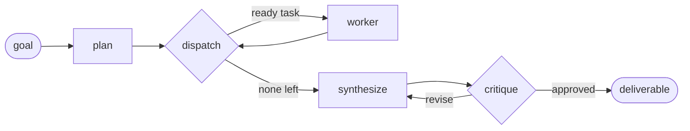

# Multi-Agent Orchestration — Autonomous Task Decomposition (PoC)

A working proof-of-concept where **specialized AI agents collaborate on a multi-step task**, and the task list is **decomposed autonomously at runtime** rather than hard-coded.

A **planner** agent breaks a goal into a dependency-aware task graph → a **supervisor** routes each ready subtask to the best-suited **specialist** (researcher / analyst / coder / writer) → a **synthesizer** merges the results → a separate **critic** gates the output (and sends it back for revision if needed). Built on **LangGraph**; the LLM backend is pluggable so it runs **with or without an API key**.

> Full rationale, pattern survey, and framework comparison: [`docs/technical-design-document.md`](docs/technical-design-document.md).
> New to the code? Start with [`docs/GUIDANCE.md`](docs/GUIDANCE.md).



## Quickstart

Requires **Python 3.12 or 3.13** (3.14 not yet supported by the LangGraph stack).

```bash
cd multi-agent-orchestration
python -m venv .venv
# Windows:  .venv\Scripts\activate     macOS/Linux:  source .venv/bin/activate
pip install -e .            # installs deps + the `orchestrate` command
```

**Run it — no API key needed** (offline deterministic backend):

```bash
orchestrate --offline "Design a URL shortener service"
# or, zero-setup:
python examples/demo_offline.py
```

**Run it against real Claude** (genuine autonomous decomposition):

```bash
cp .env.example .env        # then put your key in ANTHROPIC_API_KEY
orchestrate "Compare REST and gRPC for an internal microservice and recommend one"
```

With a key present it uses `AnthropicLLM` (model `claude-opus-4-8`) automatically; without one it transparently falls back to the offline backend.

## Tests

```bash
pytest            # 10 tests: orchestration mechanics (offline) + Claude backend (mocked)
```

The offline tests run the **real LangGraph graph** against a deterministic stand-in, so a green suite is genuine evidence the decomposition, dependency scheduling, synthesis, and evaluator-optimizer loop all work end to end.

## Project structure

```
multi-agent-orchestration/
├── README.md
├── pyproject.toml / requirements.txt      # deps + `orchestrate` entrypoint
├── .env.example                           # ANTHROPIC_API_KEY for the real backend
├── docs/
│   ├── technical-design-document.md       # the TDD: patterns, framework choice, architecture
│   └── GUIDANCE.md                         # a guided walkthrough of the code
├── src/orchestrator/
│   ├── models.py        # typed domain models = the agent I/O contracts
│   ├── state.py         # the LangGraph state (shared blackboard)
│   ├── prompts.py       # one system prompt per agent (the specialization)
│   ├── agents.py        # role → system-prompt registry
│   ├── llm.py           # LLMClient protocol + AnthropicLLM + ScriptedLLM
│   ├── graph.py         # the orchestrator graph (planner/supervisor/worker/synth/critic)
│   └── cli.py           # `orchestrate` command
├── examples/demo_offline.py               # zero-setup end-to-end run
└── tests/                                 # orchestration + backend tests
```

## What this demonstrates

- **Autonomous task decomposition** — a goal becomes a typed, dependency-aware task DAG at runtime.
- **Orchestrator-worker (supervisor) pattern** — a single coordinator schedules specialists.
- **Specialization by prompt** — adding a specialist is one enum value + one prompt.
- **Evaluator-optimizer** — a *separate* critic gates quality (not self-review).
- **Production-minded seams** — pluggable LLM, typed contracts, deadlock guard, bounded loops; clear path to real tools (MCP), parallel fan-out (`Send`), persistence (checkpointers), and tracing (LangSmith).
