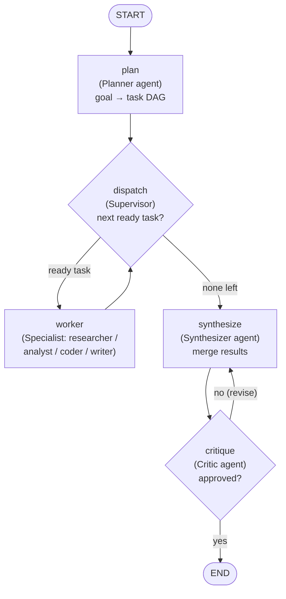
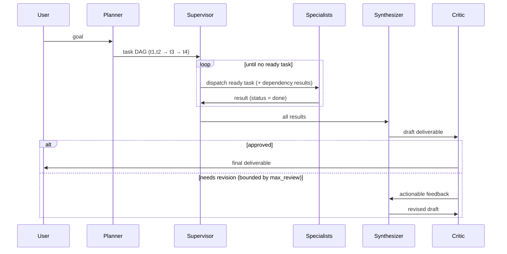

# Technical Design Document — Multi-Agent Orchestration for Autonomous Task Decomposition

| | |
|---|---|
| **Status** | Draft v1 (PoC delivered) |
| **Author** | Baris Boyukbas |
| **Date** | 2026-06-21 |
| **Repository** | `nopes/multi-agent-orchestration` |
| **Companion** | Working PoC in `src/orchestrator/` (10 passing tests; runs offline and against Claude) |

## 1. Summary

This document designs a system in which **specialized AI agents collaborate on a multi-step task**, with the task list **decomposed autonomously at runtime** rather than hard-coded. It surveys the current (2026) landscape of multi-agent orchestration patterns, selects a framework (**LangGraph**, with a reasoned comparison against **CrewAI**), and specifies an **orchestrator-worker (supervisor)** architecture: a planner agent breaks a goal into a dependency-aware task graph, a supervisor routes each ready subtask to the best-suited specialist, and a separate critic agent gates the final output.

A working proof-of-concept implements this design end to end. It is intentionally built so the orchestration mechanics run **with or without an API key** — the LLM backend is pluggable, so the same graph executes against real Claude (genuine decomposition) or a deterministic offline stand-in (for tests and key-less demos).

> **One-line thesis:** *For controllable, inspectable, autonomous task decomposition, model the system as an explicit graph — a planner that emits a typed task DAG, a supervisor loop that schedules it, specialists that execute it, and a separate evaluator that gates it.*

## 2. Goal and scope

**In scope.** A general orchestrator that takes a single high-level goal, decomposes it into subtasks at runtime, assigns each to a role-specialized agent, respects inter-task dependencies, merges the results, and quality-checks the deliverable. Framework selection and the architectural patterns behind the choice.

**Out of scope (this iteration).** Real external tools/retrieval (the specialists "reason" rather than call tools), durable cross-process persistence, a UI, and parallel worker execution. All are addressed as concrete next steps in §11.

## 3. Background: what "agent" means here

Following Anthropic's taxonomy in *Building Effective Agents* [[1]](#refs), it is useful to separate three levels of system:

- **Augmented LLM** — a single model with retrieval, tools, and memory. The base building block.
- **Workflows** — LLM calls orchestrated through *predefined code paths*. Anthropic names five: prompt chaining, routing, parallelization, **orchestrator-workers**, and evaluator-optimizer.
- **Agents** — an LLM directing its *own* process, running tools in a loop against feedback until done.

The guiding principle from that essay — and the one this design follows — is **start with the simplest pattern that works, and add agentic autonomy only when the task demands it**, because every step up that ladder trades latency, cost, and predictability for flexibility. Our task ("decompose an unpredictable goal into subtasks and delegate") sits squarely at the **orchestrator-workers** rung: the subtasks cannot be known ahead of time, so a planner must produce them at runtime — but we still want the *control* of a workflow, not the open-endedness of a fully autonomous agent.

## 4. Pattern survey (research)

### 4.1 Topologies — who can talk to whom

LangGraph's vocabulary is the cleanest way to name the options [[4]](#refs):

| Topology | Shape | Use when | Main risk |
|---|---|---|---|
| **Network** | Any agent → any agent | Maximum flexibility | Loses traceability; can loop/ping-pong |
| **Supervisor** | One coordinator → specialists | Clear specialist division, central control | Supervisor prompt becomes a bottleneck |
| **Hierarchical** | Supervisor of supervisors | One supervisor's span is too wide | More moving parts |
| **Peer / handoff** | Agents pass the baton (OpenAI Swarm → Agents SDK [[7]](#refs)) | Conversational flows (triage → billing → tech) | Context dropped if only last message is passed |

We adopt the **supervisor** topology: it is the canonical fit for "several specialists plus a coordinator," and it keeps a single, inspectable decision point.

### 4.2 Reasoning / execution loops

These govern the loop *inside* an agent:

- **ReAct** [[9]](#refs) — interleave Thought → Action → Observation. Great for dynamic, tool-driven steps; can wander, with no global plan.
- **Plan-and-Execute** [[10]](#refs) — plan the whole step list first, then execute (often with a cheaper executor), replanning on failure. Fewer LLM calls, inspectable plan, better long-horizon coherence; a bad initial plan propagates.
- **Reflexion / self-reflection** [[11]](#refs) — an agent critiques its own output and retries. Powerful, but a model grading *its own* work tends to approve it.
- **Evaluator-optimizer** [[1]](#refs) — a **separate** generator/critic pair iterating against explicit criteria. Mitigates the self-approval bias of single-model reflection.
- **Blackboard** [[12]](#refs) — specialists watch a shared solution state and contribute opportunistically. Recent work reports double-digit gains on discovery tasks, at the cost of tricky coordination.

This design uses **decomposition-first planning** (a planner emits the full task graph up front) for the orchestration layer, and an **evaluator-optimizer** loop for quality — deliberately *not* self-reflection, for the bias reason above.

### 4.3 Task decomposition — turning a goal into subtasks

Two strategies:

- **Decomposition-first (plan / DAG).** A planner emits a dependency-aware DAG of subtasks. The reference architecture is **LLMCompiler** [[8]](#refs): a *Planner* streams a DAG (task = action + args + dependencies), a *Task-Fetching Unit* dispatches each task once its dependencies are satisfied (enabling parallelism), and a *Joiner* decides to replan or finish — reported ~3.6× speedups from parallel dispatch. Best when structure is knowable.
- **Interleaved (ReAct-style).** Decompose as you go, choosing the next subtask from the latest observation. Best when the task tree is genuinely unknowable up front.

Anthropic's research system [[2]](#refs) decomposes-then-delegates, and its single most important lesson is that **vague subtask descriptions are the top cause of duplicated, wasted work** — every subtask needs an explicit objective, output expectation, and boundaries. Our planner contract (§8) bakes this in.

**This PoC uses decomposition-first with a DAG**, because it makes the autonomous decomposition *inspectable* (you can print the plan before executing it) and sets up cleanly for parallel execution later.

### 4.4 The multi-agent debate — when multi-agent *hurts*

A design doc that recommends multi-agent must engage the strongest argument against it.

- **Cognition — "Don't Build Multi-Agents"** [[3]](#refs). Two principles: (1) *share full context and agent traces, not just final messages*; (2) *actions carry implicit decisions, and parallel agents with split context make conflicting ones*. Their recommendation for most work is a **single-threaded linear agent**; notably, Claude Code uses subagents but they **never write code in parallel** — they only answer scoped read-only questions, side-stepping conflicting decisions.
- **Anthropic — multi-agent research system** [[2]](#refs). Multi-agent *won*: a lead + subagents beat a single agent by **90.2%** on their research eval, and parallelization cut wall-clock time up to **90%** — but they scope this explicitly to **breadth-first, read-heavy, parallelizable** work and warn it is a *poor* fit for coding (tight interdependencies). They also measured that multi-agent systems burn **~15× the tokens** of a single chat, and that token usage alone explained **80%** of the performance variance.

**Reconciliation (this design's stance):** the disagreement is mostly about **task shape**. Multi-agent helps when subtasks are genuinely independent and read-oriented; it hurts when subtasks must stay decision-consistent (e.g. editing one artifact). Both camps agree the real lever is **context engineering**. Our architecture honors this by (a) defaulting to **sequential** specialist execution rather than uncoordinated parallelism, (b) passing each worker the **results of its dependencies** as explicit context, and (c) keeping a single supervisor as the consistent decision-maker. We do *not* claim multi-agent is universally better — §11 notes exactly when to collapse this back to a single agent.

### 4.5 Emerging standards (one line each)

- **MCP (Model Context Protocol)** — the de-facto standard for connecting an agent *vertically* to tools and data. Our natural integration point for giving specialists real tools (§11).
- **A2A (Agent2Agent)** — an open protocol for *horizontal* agent-to-agent interop across frameworks/teams [[13]](#refs); complementary to MCP.
- **OpenAI Agents SDK** — the production successor to Swarm; the reference implementation of the handoff/supervisor style [[7]](#refs).

## 5. Framework selection — LangGraph vs CrewAI

The goal permits either. The deciding questions: *how autonomous must decomposition be, and how much control / inspectability / recoverability do we want?*

| Dimension | **LangGraph** [[4]](#refs)[[5]](#refs) | **CrewAI** [[14]](#refs) |
|---|---|---|
| Abstraction | Low-level **graph** (`StateGraph`, nodes, edges, typed state) | High-level **role-based** (Agent/Task/Crew); *Flows* add a graph-ish layer |
| Control & determinism | High — every transition is explicit | Lower for Crews (autonomous loop); higher with Flows |
| Autonomous decomposition | You design it; typed plan via structured output | Built-in via hierarchical **manager** + `planning=True`, but **over pre-authored task slots** |
| Cyclic / conditional flows | First-class (conditional edges, loops) | Crews ~linear; Flows add branching |
| Persistence & human-in-the-loop | **Strong** — checkpointers + `interrupt()`/resume | Less mature; Flow state has run IDs |
| Observability | LangSmith + LangGraph Studio | Lighter native tooling |
| Learning curve | Steeper (graph model) | Gentle (team metaphor) |
| Dependency weight | Lean core | Heavier (~47 transitive deps; chromadb/onnxruntime; fast-moving litellm) |
| Python support (2026) | 3.10–3.13 (3.14 pending) | 3.10–3.13 (**3.14 unsupported**) |
| Maturity | LangGraph 1.x; graph API frozen until 2.0 | CrewAI 1.x GA, decoupled from LangChain |

**Decision: LangGraph for the PoC.** Rationale:

1. **The thesis is autonomous *decomposition with control*.** LangGraph makes the decomposition a first-class, *inspectable* artifact: the planner returns a typed `Plan` (validated by Pydantic via structured output [[6]](#refs)), and you can print/inspect the DAG before any work runs. CrewAI's "autonomous decomposition" is, per its own docs and field reports, **manager-mediated delegation over a task list you still author** [[14]](#refs) — a weaker demonstration of true goal→subtask generation, and its manager-worker loop has documented reliability issues.
2. **Control, persistence, recoverability** are exactly what a production-credible orchestrator needs, and they are LangGraph's strengths (conditional edges for the supervisor loop, checkpointers + `interrupt()` for human-in-the-loop and resume).
3. **Engineering credibility & footprint.** A lean, explicit graph reads as a deliberate engineering artifact; CrewAI's heavy dependency tree and lack of Python 3.14 support are friction for a reproducible PoC.

**When CrewAI would win:** if the objective were "stand up a role-based team in the fewest lines" and the work maps neatly to "manager + specialists," CrewAI's ergonomics are hard to beat. A reasonable productionization path is: *prototype the role story in CrewAI for speed; port to LangGraph when hard requirements on determinism, persistence, and observability appear.*

## 6. Architecture

The system is the **orchestrator-worker (supervisor)** pattern, implemented as a LangGraph `StateGraph`.



### 6.1 Components

| Component | File | Responsibility |
|---|---|---|
| **State** | `state.py` | A `TypedDict` blackboard: `goal`, `subtasks` (live plan), `current_task_id`, `final_output`, `review_feedback`, `approved`, and an append-only `log`. |
| **Planner** | `graph.plan_node` + `llm.plan` | Decomposes the goal into a typed `Plan` (the DAG). |
| **Supervisor** | `graph.dispatch_node` + conditional edge | Picks the next subtask whose dependencies are all `done` (topological readiness), or routes to synthesis when none remain. |
| **Specialists** | `agents.py` + `graph.worker_node` | Role-specialized workers (researcher / analyst / coder / writer). A worker = a role's system prompt + the shared LLM. |
| **Synthesizer** | `graph.synthesize_node` + `llm.synthesize` | Integrates subtask results into one deliverable; revises on critic feedback. |
| **Critic** | `graph.critique_node` + `llm.critique` | A *separate* evaluator-optimizer; loops back to re-synthesize on rejection, bounded by `max_review`. |
| **LLM backend** | `llm.py` | `LLMClient` protocol with two implementations (`AnthropicLLM`, `ScriptedLLM`). |

### 6.2 Why a pluggable LLM backend

The graph depends only on the `LLMClient` protocol. This yields three properties that matter for a credible deliverable:

- **Testable without secrets.** The full pipeline (decomposition, scheduling, synthesis, critique) is exercised by deterministic tests against `ScriptedLLM` — a green suite is *real* evidence the orchestration works.
- **Demoable without a key.** `default_llm()` falls back to the offline backend when `ANTHROPIC_API_KEY` is absent, so the system always runs.
- **Honest about the boundary.** Offline mode proves the *framework*; genuine autonomous decomposition requires the real backend. The two are cleanly separated rather than conflated.

### 6.3 Anthropic integration

`AnthropicLLM` uses the official `anthropic` SDK with model `claude-opus-4-8`:

- **Structured calls** (planner, critic) use `messages.parse(output_format=PydanticModel)` so the returned plan/verdict is schema-validated, with a **forced tool-use fallback** for resilience across SDK/model versions.
- **Free-form calls** (specialists, synthesizer) use `messages.create` with **adaptive thinking** (`thinking={"type": "adaptive"}`).

## 7. Agent roles

| Role | Kind | Job | Specialized by |
|---|---|---|---|
| **Planner** | Orchestration | Goal → 2–6 dependency-aware subtasks, each with a self-contained instruction | `PLANNER_SYSTEM` + the `Plan` schema |
| **Researcher** | Specialist | Gather concrete, organized information | `RESEARCHER_SYSTEM` |
| **Analyst** | Specialist | Weigh inputs, compare trade-offs, recommend | `ANALYST_SYSTEM` |
| **Coder** | Specialist | Write/explain minimal, correct code | `CODER_SYSTEM` |
| **Writer** | Specialist | Turn material into clear prose | `WRITER_SYSTEM` |
| **Synthesizer** | Orchestration | Integrate results into one deliverable | `SYNTHESIZER_SYSTEM` |
| **Critic** | Orchestration | Approve or return actionable revisions | `CRITIC_SYSTEM` |

Specialization is entirely a function of the **system prompt** bound to a uniform worker — adding a new specialist is one enum value + one prompt, no graph change.

## 8. Task-decomposition approach

### 8.1 The planner contract (the autonomous part)

The planner is forced to emit this typed structure (its JSON Schema *is* the agent interface):

```text
Plan = { subtasks: [ SubTask ... ] }
SubTask = {
    id:          "t1" | "t2" | ...        # stable, unique
    title:       short imperative
    description: self-contained instruction (actionable WITHOUT seeing the goal)
    role:        researcher | analyst | coder | writer
    depends_on:  [ ids of prerequisite subtasks ]   # the DAG edges
}
```

The system prompt encodes the lessons from §4.3: *prefer the smallest decomposition; no vague tasks; every description self-contained; dependencies explicit.* Because the output is a validated Pydantic model, a malformed plan fails fast rather than corrupting the run.

### 8.2 Scheduling (the supervisor)

`dispatch` implements **topological readiness**: it selects the next `pending` subtask whose `depends_on` are all `done`. Independent subtasks become ready first; dependent ones wait for their inputs. A **deadlock guard** falls back to any pending task if a malformed/cyclic plan leaves nothing strictly ready, so the graph can never hang. Each worker receives the **results of its dependencies** as explicit context — the "share context" lesson from the multi-agent debate (§4.4), in miniature.

### 8.3 A run, step by step



This is exactly the trace the PoC prints (see §10).

## 9. Cross-cutting concerns

| Concern | This design | Production direction (§11) |
|---|---|---|
| **Shared state / memory** | Single typed `State` blackboard; workers get dependency results as context | Pass *references* to externalized artifacts, not full payloads, to dodge the context limit [[2]](#refs) |
| **Error handling** | Deadlock guard in scheduling; bounded critic loop; structured-output validation fails fast | Per-task retries; checkpoint + resume |
| **Human-in-the-loop** | Not in PoC | LangGraph `interrupt()` for approval gates at high-risk steps |
| **Observability** | Append-only `log` trace printed per run | LangSmith tracing of decisions/interactions, not just outputs |
| **Cost** | Sequential by default; smallest-decomposition prompt; bounded reviews | Strong lead + cheaper specialist model; cap subtask count (multi-agent ≈ 15× tokens [[2]](#refs)) |
| **Quality** | Separate critic (evaluator-optimizer), not self-reflection | LLM-as-judge eval set on a fixed sample [[2]](#refs) |

## 10. The PoC — what's implemented and evidence

Implemented: planner, supervisor with DAG scheduling, four specialists, synthesizer, evaluator-optimizer critic loop, two LLM backends, a CLI, and a test suite. Runs on Python 3.13, LangGraph 1.2.6, anthropic 0.111.0.

**Verification (offline, deterministic — no API key):**

```
$ orchestrate --offline "Design a URL shortener service"

plan: decomposed goal into 4 subtasks
  - t1 [researcher] Gather background
  - t2 [researcher] Gather constraints
  - t3 [analyst] Analyze findings (depends on t1, t2)
  - t4 [writer] Write the deliverable (depends on t3)
dispatch: selected t1 (researcher)
worker: executed t1 (researcher) - Gather background
dispatch: selected t2 (researcher)
worker: executed t2 (researcher) - Gather constraints
dispatch: selected t3 (analyst)
worker: executed t3 (analyst) - Analyze findings
dispatch: selected t4 (writer)
worker: executed t4 (writer) - Write the deliverable
dispatch: all subtasks complete
synthesize: synthesized deliverable
critique: rejected (round 1) - Add an explicit summary line up front.
synthesize: re-synthesized deliverable
critique: approved after 2 review(s)
```

The trace shows every designed behavior: runtime decomposition, dependency-aware ordering (t3 after both t1 and t2; t4 after t3), specialist routing, synthesis, and a real evaluator-optimizer revision cycle.

**Test suite — `10 passed`:** decomposition produces a valid DAG; all subtasks complete with specialists assigned; dependencies are respected in execution order; the evaluator-optimizer loop revises then approves; the loop is bounded; and the `AnthropicLLM` backend is verified via a mock client (structured output, text extraction, typed critique, and tool-use fallback) so the real-Claude path is covered without a network call.

## 11. Limitations and next steps

**Known limitations.** Specialists reason but don't call real tools; execution is sequential; persistence is in-memory only; offline mode's decomposition is scripted (the *framework* is proven offline, real decomposition needs the key).

**Roadmap (in priority order):**

1. **Real tools via MCP** — give the researcher web/retrieval tools and the coder a code sandbox; this is where the system becomes genuinely useful.
2. **Parallel fan-out** — dispatch independent ready tasks concurrently with LangGraph's `Send` (map-reduce); requires a reducer on shared state keys to avoid write conflicts. Expected to recover much of the LLMCompiler-style speedup.
3. **Durable persistence + human-in-the-loop** — add a `SqliteSaver`/`PostgresSaver` checkpointer and `interrupt()` approval gates for high-risk actions.
4. **Observability** — wire LangSmith to trace routing decisions and catch supervisor loops.
5. **Eval harness** — a small LLM-as-judge set scoring accuracy/completeness, run in CI.
6. **Know when *not* to use this.** For write-heavy, decision-coupled tasks (editing one artifact), collapse to a single-threaded agent — per §4.4, that is where multi-agent reliably underperforms.

## 12. References {#refs}

1. Anthropic — *Building Effective Agents.* https://www.anthropic.com/engineering/building-effective-agents
2. Anthropic — *How we built our multi-agent research system.* https://www.anthropic.com/engineering/multi-agent-research-system
3. Cognition (Walden Yan) — *Don't Build Multi-Agents.* https://cognition.com/blog/dont-build-multi-agents
4. LangGraph — Multi-agent supervisor / graph API. https://reference.langchain.com/python/langgraph-supervisor · https://docs.langchain.com/oss/python/langgraph/graph-api
5. LangGraph v1 release notes. https://docs.langchain.com/oss/python/releases/langgraph-v1
6. LangChain — `ChatAnthropic` / structured output. https://docs.langchain.com/oss/python/integrations/chat/anthropic
7. OpenAI Agents SDK. https://openai.github.io/openai-agents-python/
8. Kim et al. — *LLMCompiler: An LLM Compiler for Parallel Function Calling.* https://arxiv.org/pdf/2312.04511
9. Yao et al. — *ReAct: Synergizing Reasoning and Acting in Language Models.* https://arxiv.org/abs/2210.03629
10. LangChain — *Plan-and-Execute / Planning Agents.* https://blog.langchain.com/planning-agents/
11. *Reflection / Reflexion overview.* https://huggingface.co/blog/Kseniase/reflection
12. *LLM-Based Multi-Agent Blackboard System.* https://arxiv.org/abs/2510.01285
13. IBM — *What is the Agent2Agent (A2A) Protocol.* https://www.ibm.com/think/topics/agent2agent-protocol
14. CrewAI — Flows / Hierarchical Process / Planning docs. https://docs.crewai.com/en/concepts/flows · https://docs.crewai.com/en/learn/hierarchical-process · https://docs.crewai.com/en/concepts/planning

*Some quantitative figures (LLMCompiler ~3.6×; Anthropic 90.2% / ~15× / 80%; blackboard gains) are quoted from the sources above; treat framework version numbers and model IDs as point-in-time (2026-06) and re-verify before publishing externally.*
